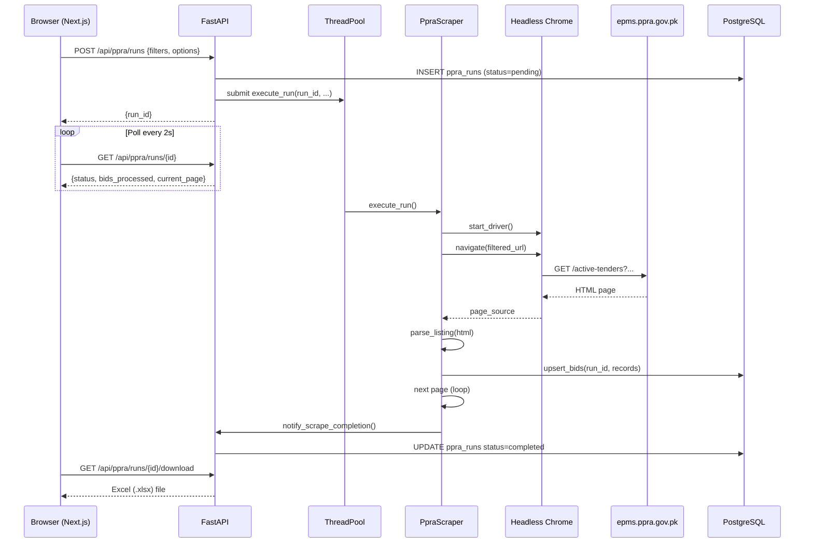

# PK-Hub — Architecture

## 1. Repository Layout

```
pk-hub/
├── client/                        # Next.js 16 frontend
│   ├── src/
│   │   ├── app/                   # App Router pages
│   │   │   ├── page.tsx           # Home / portal cards
│   │   │   ├── console/
│   │   │   │   └── [portal]/      # Per-portal console
│   │   │   │       ├── page.tsx
│   │   │   │       ├── history/
│   │   │   │       └── exports/
│   │   ├── components/
│   │   │   ├── ConsoleShell.tsx   # Sidebar + layout
│   │   │   ├── RunControls.tsx    # Start / Stop / Pause
│   │   │   ├── ProgressBar.tsx
│   │   │   └── panels/
│   │   │       ├── PpraPanel.tsx
│   │   │       └── KppraPanel.tsx
│   │   └── lib/
│   │       ├── portals.ts         # Portal registry (PK-only)
│   │       ├── api.ts             # Typed fetch wrappers
│   │       └── utils.ts
│   ├── public/
│   ├── tailwind.config.ts
│   ├── tsconfig.json
│   └── package.json
│
├── server/                        # FastAPI backend
│   ├── app/
│   │   ├── config.py              # Settings (pydantic-settings)
│   │   ├── db.py                  # SQLAlchemy session factory
│   │   ├── main.py                # FastAPI app, CORS, routers
│   │   ├── core/
│   │   │   ├── base_scraper.py    # Selenium machinery
│   │   │   ├── run_manager.py     # Run lifecycle & state
│   │   │   ├── jobs.py            # ThreadPoolExecutor wrapper
│   │   │   ├── exports.py         # ZIP / Excel packaging
│   │   │   ├── closing_filter.py  # 7-day close guard
│   │   │   ├── checkpoints.py     # Pause / resume state
│   │   │   └── live.py            # Live screenshot bus
│   │   ├── scrapers/
│   │   │   ├── ppra/
│   │   │   │   ├── scraper.py
│   │   │   │   ├── parsers.py
│   │   │   │   ├── repository.py
│   │   │   │   ├── schemas.py
│   │   │   │   ├── models.py
│   │   │   │   ├── export.py
│   │   │   │   ├── filters.py
│   │   │   │   └── router.py
│   │   │   └── kppra/             # (Phase 2)
│   │   └── services/
│   │       └── notifier.py        # Slack / email after run
│   ├── migrations/
│   │   └── YYYY-MM-DD_*.sql
│   ├── tests/
│   ├── data/                      # Local JSONL mirrors per run
│   └── logs/
│
├── .env.example
├── run-server.bat / run-server.sh
├── run-client.bat / run-client.sh
└── README.md
```

---

## 2. Stack

### Frontend
| Layer | Choice | Why |
|-------|--------|-----|
| Framework | **Next.js 16** (App Router) | SSG for portal pages, RSC for data loading |
| Language | **TypeScript 5** (strict) | Same as scraping-hub; no JS regressions |
| Styling | **Tailwind CSS 4** | Utility-first; design tokens as CSS vars |
| Icons | **Lucide React** | Consistent, tree-shakeable |
| State | URL as source of truth + `useState` | No Redux; portal key lives in the path |
| Data | `fetch` + SWR polling | Real-time run progress without WebSockets |

### Backend
| Layer | Choice | Why |
|-------|--------|-----|
| Framework | **FastAPI** (Python 3.12+) | Async, Pydantic v2 validation, auto OpenAPI |
| ORM | **SQLAlchemy 2** (sync sessions) | Matches scraping-hub battle-tested patterns |
| DB | **PostgreSQL 15** | JSONB for raw_data, robust `ON CONFLICT` upserts |
| Browser | **Selenium 4** + **ChromeDriver** (webdriver-manager) | Required for JS-rendered portal pages |
| HTML parsing | **BeautifulSoup4** (lxml) | Proven against responsive PPRA tables |
| Concurrency | `ThreadPoolExecutor` (one thread per portal run) | Simple; scrapers are I/O-bound, not CPU |
| Config | **pydantic-settings** + `.env` | Type-safe, same pattern as scraping-hub |

---

## 3. Data Flow



---

## 4. API Contract

### Runs
```
POST   /api/{portal}/runs               → {run_id}       Start a new run
GET    /api/{portal}/runs               → Run[]           List all runs
GET    /api/{portal}/runs/{id}          → Run             Run status + progress
DELETE /api/{portal}/runs/{id}/stop     → 204             Request graceful stop
POST   /api/{portal}/runs/{id}/pause    → 204             Pause at next checkpoint
POST   /api/{portal}/runs/{id}/resume   → 204             Resume a paused run
GET    /api/{portal}/runs/{id}/bids     → Bid[]           Paged results
GET    /api/{portal}/runs/{id}/download → file            Excel export (or ZIP)
GET    /api/{portal}/runs/{id}/logs     → LogLine[]       Streaming run logs
```

### Reference
```
GET    /api/{portal}/filter-options     → {kind: Option[]} Dropdown options
GET    /api/health                      → {status: "ok"}
```

### Live Preview
```
GET    /api/{portal}/runs/{id}/screenshot → PNG (base64)  Live browser frame
```

---

## 5. Scraper Lifecycle

```
pending → running → scraping_pages → packaging_results → completed
                                                        ↘ stopped (user)
                                                        ↘ failed (error)
```

- **`pending`**: run created in DB, worker not yet picked up
- **`running`**: Chrome launched, navigating to portal
- **`scraping_pages`**: pagination loop — upserts per page, progress ticks
- **`packaging_results`**: Excel written, ZIP assembled
- **`completed`** / **`stopped`** / **`failed`**: terminal states

Stop is cooperative: `raise_if_stopped()` is called at every page boundary and record boundary, so a stop lands within ≤1 page of the user clicking it.

---

## 6. Portal Module Structure

Every portal follows the same 8-file layout:

| File | Responsibility |
|------|---------------|
| `scraper.py` | Selenium driver, pagination loop, filter URL builder |
| `parsers.py` | Pure HTML → `dict` (no I/O, fully unit-testable) |
| `repository.py` | DB reads / writes, `_safe_date`, `_safe_datetime` |
| `models.py` | SQLAlchemy ORM models |
| `schemas.py` | Pydantic request/response models |
| `export.py` | Excel / ZIP packaging |
| `filters.py` | Dropdown option helpers |
| `router.py` | FastAPI `APIRouter` — all HTTP endpoints for this portal |

---

## 7. Concurrency & Safety

- Maximum **2 concurrent runs** per portal (configurable via `MAX_CONCURRENT_RUNS`)
- Each run gets its own `run_dir` and `_downloads/` staging folder
- Browser instances are isolated: one `webdriver.Chrome` per run, quit on completion
- `ThreadPoolExecutor` size set to `MAX_CONCURRENT_RUNS * num_portals + 2`
- Stop signal is polled cooperatively — no `SIGKILL`; the browser is quit cleanly

---

## 8. Deployment & Execution (Zero Docker)

```
┌─────────────────────┐     ┌───────────────────────┐
│   Next.js Client    │────▶│    FastAPI Server     │
│   (Node 20+ npm)    │     │  (Python 3.12+ .venv) │
└─────────────────────┘     └──────────┬────────────┘
                                        │
                            ┌───────────▼────────────┐
                            │   PostgreSQL 15+        │
                            │   (Local Windows Service│
                            │    or Cloud / Neon)     │
                            └────────────────────────┘
```

- **Zero Docker**: Runs natively directly on Windows / Linux using:
  - Client: `npm install && npm run dev` (or `npm run build && npm start`)
  - Server: Python virtual environment (`python -m venv .venv`, `pip install -r requirements.txt`, `uvicorn app.main:app --reload`)
  - Browser: Selenium launches your installed Google Chrome via `webdriver-manager` without container overhead.
  - Database: Native PostgreSQL installed as a Windows service or remote managed database (Supabase / Neon / RDS).
