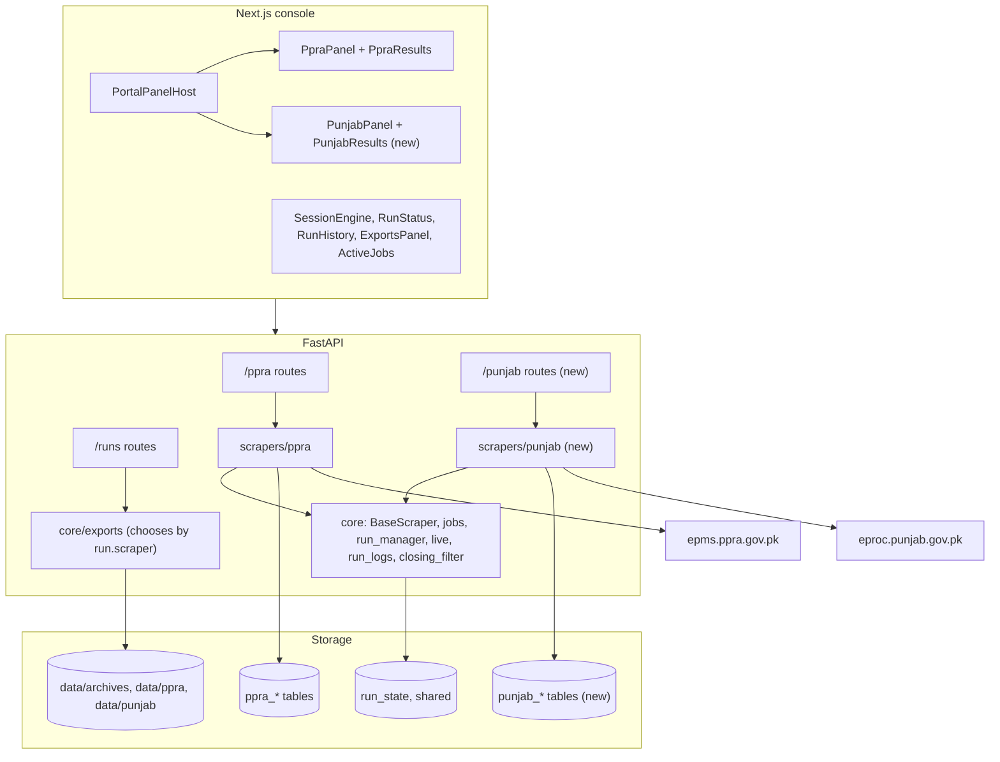

# Architecture: PPRA Punjab Scraper

How the Punjab portal fits into PK-Hub, and how it stays separate from federal PPRA. The site's behaviour and the detailed logic are in [system-design.md](system-design.md).

In these documents, **PPRA** means the existing federal portal (`epms.ppra.gov.pk`) and **Punjab** means the new portal (`eproc.punjab.gov.pk`).

---

## 1. Big picture

Punjab is a second, separate package beside PPRA. Both use the same shared core.

---

## 2. What each part owns

| Part | Owner | Notes |
|---|---|---|
| Chrome startup, retries for `driver.get`, pause, stop, screenshots | `core/base_scraper.py` | Reused by subclassing |
| Worker pool and queue | `core/jobs.py` | Reused. PPRA and Punjab share the same slots (3 by default) |
| Run state | `core/run_manager.py` | Reused. Already stores a `scraper` key and accepts extra fields |
| `/runs` endpoints | `core/download_router.py` | Reused with no edit. Works by run id |
| Closing guard | `core/closing_filter.py` | Reused. It receives ISO dates only |
| Excel styling | `core/excel_style.py` | Reused |
| Email | `services/notifier.py` | Reused. It already goes through `exports` and takes the portal name |
| Form, paging, row reading, tables, workbook | `scrapers/punjab/` | New |

---

## 3. New server package

`server/app/scrapers/punjab/` follows the PPRA layout, so anyone who knows PPRA can find things.

| File | Job | Differs from PPRA because |
|---|---|---|
| `parsers.py` | Rows, tender ID, pager, dropdowns, `is_auction`, link and date checks | RadGrid table, no tender number |
| `scraper.py` | `PunjabScraper(BaseScraper)` and `execute_run` | Clicks and postbacks instead of URLs |
| `filters.py` | Dropdown cache, labels, filter hash | No search URL. Lists refresh through Chrome |
| `filter_options.json` | Built-in dropdown copy | About 4,900 departments |
| `schemas.py` | Request models | Different filters, stricter validation |
| `models.py` | Three tables | Different fields |
| `repository.py` | DB writes and JSONL mirror | Mirror goes to `data/punjab/<run_id>/` |
| `router.py` | `/punjab` routes | Same route shapes as `/ppra` |
| `export.py` | Workbook and `excel_name` | Two PDF link columns, no closing time |

**Why it doesn't import from `scrapers/ppra/`:** a future PPRA change could then break Punjab, or the reverse. Small repeated code is cheaper than that link.

---

## 4. Changes to existing files

This is the complete list. Anything not listed stays as it is.

### Server

| File | Change | Risk to PPRA |
|---|---|---|
| [core/exports.py](../server/app/core/exports.py) | In `excel_name` (line 27) and `excel_bytes` (line 81), use the Punjab exporter when `run["scraper"] == "punjab"`. All other runs take today's path | **Medium.** It's on PPRA's download path, so it has dedicated tests |
| [db.py](../server/app/db.py) | Import Punjab models beside line 19 | Low. `create_all` only adds missing tables |
| [main.py](../server/app/main.py) | Include the router, warm the filter cache, add `punjab` to the health list | Low. The cache warm-up must sit in its own `try` |
| [config.py](../server/app/config.py) | Add `punjab_*` settings | None |
| `.env.example` | List the new optional settings | None |

**Why `exports.py` must change:** lines 32 and 85 always load PPRA code. Without this change, a Punjab download would build a PPRA workbook from the wrong table. Email attachments use the same path, so the same edit fixes both.

### Client

| File | Change | Risk to PPRA |
|---|---|---|
| [lib/api.ts](../client/src/lib/api.ts) | `Portal` becomes `"ppra" \| "punjab"`. Add optional run fields and Punjab calls | Low. Added fields are optional |
| [lib/portals.ts](../client/src/lib/portals.ts) | Add an entry | Low. Keep PPRA first, because `portalMeta` falls back to `PORTALS[0]` |
| [PortalPanelHost.tsx](../client/src/components/PortalPanelHost.tsx) | Take a `portal` prop and choose the panel | Medium. It is how the PPRA panel appears |
| [ConsoleShell.tsx](../client/src/components/ConsoleShell.tsx) | Pass `portal` at line 200, update footer text at line 211 | Low |
| [RunHistory.tsx](../client/src/components/RunHistory.tsx) | Choose results by `selected.scraper` at line 49 | Low |
| [RunStatus.tsx](../client/src/components/RunStatus.tsx) | Add a label for a new step and the auction note | Low. Existing labels stay |
| [app/page.tsx](../client/src/app/page.tsx) | Add a Punjab card | None |

### Works with no edit

These read from `PORTALS` or from run data, so Punjab appears automatically:

- The sidebar, `/console/[portal]` routes and static pages
- `SessionEngine.tsx`, `sessions.ts` and `usePortalSession.ts`. Each portal has its own session slot, and the status URL is built from the portal key
- `ActiveJobs.tsx`, `ExportsPanel.tsx`, `LiveMonitor.tsx`, `ScraperControls.tsx`, `StopButton.tsx`, `RefreshButton.tsx`, `SessionActivity.tsx`

---

## 5. How PPRA stays safe

| Protection | How |
|---|---|
| Separate code | Nothing in `scrapers/ppra/` is edited. The plan's gate checks that this diff is empty |
| Separate tables | New tables only. `create_all` doesn't alter existing tables, so no migration is needed |
| Separate data folder | `data/punjab/` beside `data/ppra/` |
| Safe default | In `exports.py`, only the exact value `punjab` takes the new path. Older runs and anything unexpected still get PPRA's behaviour |
| Separate failures | A Punjab run that fails ends only that run. The filter cache warm-up can't stop the server from starting |
| Separate slots in the browser | `sessions.ts` holds one slot per portal, so the two consoles can't overwrite each other |
| Tests | Existing PPRA tests stay unchanged. New tests prove each portal gets its own export |

### One shared limit

Both portals share the worker pool. With the default of 3 slots, Punjab runs can make a PPRA run wait in the queue. This is the pool working as designed, and each Chrome uses about 300 to 500 MB. Raise `SCRAPE_CONCURRENCY` only if the machine has memory to spare.

---

## 6. Rules the shared code expects

The shared code and console rely on these names. If Punjab uses different ones, things fail quietly, for example a blank count or a missing Download button.

### Run fields (`run_manager`)

| Field | Used by |
|---|---|
| `total_expected`, `total_pages`, `current_page` | Status card |
| `bids_found` (the site's total), `bids_processed` (rows saved) | Status card, jobs bar, history |
| `skipped_closing`, `kept_unverified` | Closing guard note |
| `filters`, `options`, `search`, `live_preview` | History, Refresh, Chrome start |
| `skipped_auction`, `skipped_repeat` | **New**, optional |

### Option names

`RunStatus.tsx` reads `closing_runway_days` and `apply_closing_filter` directly from `run.options`. `PunjabOptions` must use the same two names and the same meaning as `get_runway_days()`. The new option is `exclude_auctions`.

In `api.ts`, `RunStatus.options` becomes `PpraOptionsPayload & PunjabOptionsPayload`. All fields are optional, so the existing `exclude_karachi` check keeps compiling.

### Step names

| Step | Meaning |
|---|---|
| `opening_punjab` | **New.** The existing `opening_site` label says `Opening epms.ppra.gov.pk`, so Punjab uses its own step and PPRA's label stays as it is |
| `page_<n>_of_<m>` | Must match this exact form, because `stepLabel` reads it with a pattern |
| `scraping_pages`, `packaging_results`, `completed`, `failed` | Same as PPRA |

### Finishing order

`execute_run` must keep PPRA's order, or the Download button and Run Summary go wrong:

1. Write the final status to `punjab_runs`, because the workbook reads it
2. `archive_run(run_id)`
3. `notify_scrape_completion(run_id, "punjab", count)`
4. `update_run(status="completed")`

For a stop, call `deliver_partial()`, which sets `partial_results`. The download endpoint needs that field. `flush_partial()` must return the saved row count.

### Stopping during a page load

`stop()` quits the browser from another thread. A click or wait in progress then raises `WebDriverException`. Call `raise_if_stopped()` in that handler first, so a stop ends as stopped and not as failed or as a short "completed" run. PPRA does this at [scraper.py:165](../server/app/scrapers/ppra/scraper.py#L165).

---

## 7. Known issues inherited from the shared code

These exist today and also apply to Punjab. They aren't caused by this work, and this plan doesn't fix them.

| Issue | Effect |
|---|---|
| After a server restart, `load_persisted_runs` marks an unfinished run as failed in `run_state`, but the portal's own run row stays `running` | That run's Excel summary can show the wrong status |
| `PortalPanelHost` returns nothing when hidden | Form values are lost when moving to History and back. A running scrape is not affected |
| Run history is held in memory and restored from the database at startup | Every run loads at startup. Fine at this size, but there's no cleanup |
