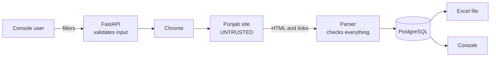

# Security: PPRA Punjab Scraper

The security risks for this work, the controls to build, and the rules for how we treat the target site.

**Summary:** the main risk is trusting what the site sends us. The site is old (IIS 7.5), and anything it returns could end up in a browser or an Excel file. So all scraped data is treated as untrusted. The local API also has no login, so it must stay on this machine.

---

## 1. What we are protecting

| Asset | Why it matters |
|---|---|
| Database password and AWS SES credentials | Direct access to data and email sending |
| The machine running Chrome | Chrome loads a remote site, and the shared code runs it with its sandbox off |
| People opening the Excel files | A harmful cell or link would run on their computers |
| Accuracy of the data | Business decisions depend on it |
| Good standing with the site | An overloaded government server hurts them, and a block hurts us |

**Data sensitivity:** tender data is public. The fields we store hold no personal data on purpose. PDFs may contain officers' names, but we don't download them.

---

## 2. Trust boundaries



Two inputs cross into our system: what the site sends, and what the API receives. Both are checked at the point they enter.

---

## 3. Threats

| # | Threat | Example | Severity | Control |
|---|---|---|---|---|
| T1 | Harmful link stored from the site | A `javascript:` link runs in the console when clicked | High | C1 |
| T2 | Excel formula injection | A title starting with `=` runs as a formula. openpyxl treats such strings as formulas. None of today's 934 rows start with a risky character, but the site controls this text | High | C2 |
| T3 | Bad input reaches the browser script | A crafted value changes the JavaScript we run | Medium | C3, C4 |
| T4 | Mixing portals | A PPRA run id sent to the Punjab Refresh route | Low | C5 |
| T5 | Secret exposure | Password in a log, an error or a commit | High | C6 |
| T6 | A changed site gives wrong data silently | Columns move and values land in the wrong fields | Medium | C7 |
| T7 | Overloading the site | Runs with no delay | Medium | C8 |
| T8 | Harmful page attacks Chrome | A compromised site attacks a browser with no sandbox | Medium | G2, not fixed here |
| T9 | Local API is exposed | Someone on the network starts or stops runs | Medium | G1, not fixed here |

---

## 4. Controls to build

Each one needs a test.

### C1: Accept only expected links

Store a PDF link only if it matches the exact pattern below, then join it to the fixed site address. All 1,868 links from the 934 live rows match it.

```text
^(Tenders|BiddingDocuments)/\d+/\d+/\d{28,}\.pdf$
```

Anything else is stored as empty and counted in a run warning. This protects both the console's `href` and the Excel hyperlinks.

### C2: Make Excel treat scraped text as text

- Pass every scraped value through `excel_style.sanitize_cell`, which removes characters Excel refuses
- Force scraped text cells to be strings, so a leading `=` can't become a formula
- Also neutralise a leading `+`, `-`, `@`, tab or carriage return, which can act as formulas in other spreadsheet programs
- Add a test with the title `=HYPERLINK("http://example.com","x")`

Only the Days Left formula, which we build ourselves, may be a formula.

### C3: Validate API input

In `PunjabFilters` and `PunjabOptions`:

- Reject unknown fields (`extra="forbid"`)
- Dropdown values must be digits only, up to 6 characters
- Dates must be real ISO dates, with `closing_from` not after `closing_to`
- `closing_runway_days` stays between 0 and 365
- Reject Title id `5` when `exclude_auctions` is on, because it can only return nothing

### C4: Never build browser scripts from strings

- Set dates by passing the value as an argument: `execute_script("arguments[0].value = arguments[1]", element, value)`
- Choose dropdowns with Selenium's `Select`
- The only value placed inside script text is the page number, and it must be an `int`

### C5: Keep portals apart

Refresh must confirm `parent_run["scraper"] == "punjab"`, and return 404 if not.

### C6: Protect secrets

- `.env` is ignored by git (confirmed with `git check-ignore`). Never commit it
- Never log `DATABASE_URL` or the settings object
- Never put real passwords in documents, tests, screenshots or chat
- Use a strong Postgres password, not the `password` placeholder in `.env.example`
- No new secrets are needed for Punjab

### C7: Detect site changes

Check the 9 column headers and the page number on every page, as described in [system-design.md](system-design.md#checking-every-page). Fail clearly instead of saving wrong data.

### C8: Stay polite

See section 5.

---

## 5. Rules for how we treat the site

| Rule | Detail |
|---|---|
| Public pages only | Never use the admin login, or any account |
| Keep the delay | 1.5 to 3 seconds between pages. Never remove it to go faster |
| Read only | We only search and page. We never change data on the site |
| Links, not files | Don't bulk-download PDFs |
| Keep certificate checks on | Never disable TLS verification because the server is old |
| Identify honestly | No personal details in the user agent |

### If the site blocks us

**Stop and ask.** If a captcha, login wall, 403 or rate limit appears, the run should fail with a clear message.

We won't build anything to get around it: no captcha solving, no rotating IPs or user agents, no new stealth settings. A block is the site owner's decision, and the right response is to slow down or contact them.

`BaseScraper` already hides automation signals, because it was written for PPRA, and Punjab inherits that. No test here needed those settings, since the tests ran on plain headless Chrome with no block. We add nothing further.

### Permission

No terms of use were found on the search or home pages, and there's no `robots.txt`. That doesn't amount to permission. The tender data is published for the public, but whether to confirm with Punjab PPRA before regular commercial use is a business and legal decision for you.

---

## 6. Existing gaps in shared code

Found while reading the code. They exist today, and this plan doesn't change them, because fixing them touches PPRA. Each needs a separate decision.

| # | Gap | Where | Risk | Suggested fix |
|---|---|---|---|---|
| G1 | The API has no login. Anyone who can reach port 8000 can start and stop runs and download results | All routes | Low while on `127.0.0.1`, which is what `run-server.bat` uses. **High** if exposed | Never use `--host 0.0.0.0` without adding login first |
| G2 | Chrome runs with `--no-sandbox` | [base_scraper.py:141](../server/app/core/base_scraper.py#L141) | Medium. The sandbox is a main defence against a harmful page | Use the flag only where it's required, such as in containers. Needs PPRA retesting |
| G3 | PPRA's Excel doesn't sanitise scraped text. A title with a leading `=` becomes a formula, and a control character can fail the export | [ppra/export.py:130](../server/app/scrapers/ppra/export.py#L130) | Medium | Apply C2 to PPRA |
| G4 | PPRA links are shown without checking | [PpraResults.tsx:144](../client/src/components/PpraResults.tsx#L144) | Medium | Apply a C1-style check |
| G5 | Other websites open in the same browser may be able to send simple requests to the local API. CORS limits reading responses, not always sending them | [main.py:34](../server/app/main.py#L34) | Low | Add a token if the API gains login |
| G6 | `webdriver-manager` downloads a driver at runtime | [base_scraper.py:107](../server/app/core/base_scraper.py#L107) | Low | Pin a known driver for production |
| G7 | Python packages use version ranges with no lock file | `requirements.txt` | Low | Add a lock file with hashes |

### Privacy note

`DNS_OVER_HTTPS` is on by default, so Chrome sends site lookups to Google and Cloudflare. They learn which site was visited, not what was searched. This is existing behaviour.

---

## 7. Release checklist

Complete in Phase 7.

- [x] Tests exist and pass for C1 to C5
- [x] A row with a bad link stores an empty link and adds a warning
- [x] A title starting with `=` shows as plain text in Excel
- [x] Bad filters return 422
- [x] Refreshing a PPRA run through `/punjab` returns 404
- [x] `git status` shows no `.env`, `data/` or `.xlsx` files
- [x] A search of the diff finds no passwords or keys
- [x] Logs from a full run contain no connection string
- [x] `pg_hba.conf` has no `trust` entries. It was clean on 5 November 2026, and must be rechecked if the password was reset after that
- [x] The server still binds to `127.0.0.1`
- [x] The page delay is active in a real run
