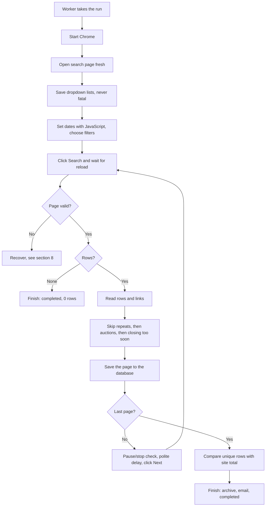

# System Design: PPRA Punjab Scraper

How the Punjab site behaves and exactly how the scraper will work. Where each piece lives is in [architecture.md](architecture.md).

| | |
|---|---|
| **Target** | <https://eproc.punjab.gov.pk/Admin_Tender_Search.aspx> |
| **Evidence** | Live headless Chrome tests on 5 November 2026, including two full passes over the live tenders |

Counts are from that day and will change. Anything not tested is listed in [section 12](#12-not-yet-tested). The code in `server/app/scrapers/punjab/` follows this design.

---

## 1. The site in brief

| Item | Finding |
|---|---|
| Server | IIS 7.5, ASP.NET 4.0 (very old) |
| Results table | Telerik RadGrid, table class `rgMasterTable` |
| Login | Not needed for the search page or PDFs. The home page is an admin login, which we never use |
| Captcha or bot block | None seen in any test |
| `robots.txt` | Doesn't exist (returns 404) |
| Page weight | About 1 MB, of which about 500 KB is hidden form state |
| Rows per page | 50, the default and the largest choice (10, 20, 50) |
| Response time | 0.6 to 3.2 seconds per page |
| Live tenders | 934 on 19 pages, rising to 936 during testing |

**Chrome is required.** `curl` and Python's standard HTTP client both failed while downloading the page (`SEC_E_INVALID_TOKEN`, `RECORD_LAYER_FAILURE`), although the headers arrived. Headless Chrome loaded it every time. The cause wasn't investigated.

### PPRA compared with Punjab

| | PPRA | Punjab |
|---|---|---|
| Search | Values in the URL | Fill the form and click Search |
| Next page | Open a new URL | Click Next, and the page posts back |
| Refresh dropdown lists | Plain HTTP | Chrome only |
| Tender ID | `TS...` number on the page | None. Built from the PDF filename |
| Detail page | Yes | No, only two PDFs |
| Closing value | Date and time | Date only |
| City | Yes | No |
| Date boxes filter on | Advertise date | **Close date** |

---

## 2. Search form

All element IDs start with `ctl00_ContentPlaceHolderSRIS_`.

| Field | ID suffix | Values |
|---|---|---|
| From Date | `txtFromDate` | `dd/mm/yyyy`, read-only box |
| To Date | `txtToDate` | `dd/mm/yyyy`, read-only box |
| Procurement Type | `ddlProcurementType` | 0 All, 1 Work, 2 Services, 3 Goods |
| Procurement Category | `ddlProcurementCategory` | 0 All, 1 Local, 2 International |
| Procurement Title | `ddlProcurementTitle` | 0 All, 3 Tender Notice, 1 Expression of Interest, 2 Request for Proposal, 8 Addendum, 9 Corrigendum, 7 Quotations, 4 Prequalification Notice, **5 Sales/Auction/Disposal**, 6 Others |
| Department | `ddlDepartment` | 4,936 departments plus All |
| Search | `btnSubmit` | |

**Department list:** always use the numeric id. There are 13 duplicate labels (`District Council, Jhang` appears three times), and some labels are junk such as `.`. Leave out labels with no letters.

---

## 3. Results table

Rows use the classes `rgRow` and `rgAltRow`.

| # | Site column | Example | Our field | Notes |
|---|---|---|---|---|
| 1 | Procurement Title | `Tender Notice` | `notice_type` | Really a category |
| 2 | Procurement Name | `Purchase of Uniform` | `title` | Up to 200 characters. 64 of 934 had double spaces, so normalise whitespace. 48 had non-English characters, so keep UTF-8 |
| 3 | Type | `Goods` | `procurement_type` | Work, Services or Goods |
| 4 | Publish Date | `30 Oct 2026` | `published_on` | Always this format |
| 5 | Close Date | `04 Nov 2026` | `closing_on` | Date only |
| 6 | Department | `The Bank of Punjab` | `department` | |
| 7 | Status | blank | `status` | Blank on 914, `Violated Tender` on 20 |
| 8 | Tender Notice | PDF link | `notice_url` | On all 934 rows |
| 9 | Bidding Document | PDF link | `document_url` | On all 934 rows |

### Data we can't get

- **Closing time:** not in the table. Trap 13 suggests the site stores one.
- **City:** only 489 of 934 departments contain a comma, and many of those end in something else (`The Bank of Punjab`). Guessing would create wrong data.
- **Local or International:** the filter works, but rows don't show the value.
- **Reference number and description:** not shown.

---

## 4. Tender ID

```text
Tenders/50485054/4949/0511202610103916431812258713.pdf
        \______/ \__/ \____________/\______/\____/
         "2026"  "11"  upload time   random  tender ID
                       05-11-2026
                       10:10:39
```

- The folders are ASCII codes: 50 48 50 54 spells `2026`, and 49 49 spells `11`.
- All 934 filenames are 28 digits long.
- The last 6 digits match between the notice and the bidding document on all 934 rows, and they are unique across the 934.
- IDs ranged from 252021 to 258747.

**Rule:** take everything after the first 22 digits, so a future 7-digit ID still works.

**Fallback:** with no usable PDF link, use `PB-` plus a hash of title, department, publish date and close date. Never use the page position, because rows move.

Each Corrigendum and Addendum has its own ID, and nothing links it to its original tender.

---

## 5. How a run works



### Dates to send

| Situation | `From` | `To` |
|---|---|---|
| Default | Today in Pakistan time | Today + 2 years |
| User sets a closing range | User's date | User's date **+ 1 day** (trap 13) |

The furthest close date seen was 30 June 2027, so 2 years is a safe margin. `Asia/Karachi` must be used for "today", as the repository already does for PPRA.

### Waiting for a page reload

Paging replaces the whole page, so anything stored on `window` disappears. That gives a reliable signal:

```python
driver.execute_script("window.__pkhub = 1")
driver.find_element(By.CSS_SELECTOR, ".rgPageNext").click()
# Poll until window.__pkhub is gone and readyState is not "loading".
# Ignore script errors during the poll: they are normal mid-reload.
# Call raise_if_stopped() inside the loop so Stop is noticed quickly.
```

### Checking every page

Don't trust a reload just because it finished. After each one, confirm all of these before saving:

1. The results table or `.rgNoRecords` exists
2. The 9 column headers match. If they don't, fail with a clear "the site has changed" message
3. `.rgCurrentPage` shows the expected page
4. A page with a pager has at least one row

The page count comes from each new page, not only the first, because the total changes during a run.

### Filter order for each row

1. **Repeat:** tender ID already seen in this run, so skip it and add to `skipped_repeat`
2. **Auction:** when `exclude_auctions` is on, skip it and add to `skipped_auction`
3. **Closing guard:** the same logic as PPRA, using `days_until_close`

Repeats are removed before saving because `upsert_bids`-style counting would otherwise count the same tender twice as new.

### Reconciling at the end

Unique rows read should equal the site's latest total. If not, add a warning. Don't fail the run, because new tenders can arrive while it runs.

---

## 6. Excluding auctions

The dropdown can pick one Procurement Title, but it can't exclude one. So we search everything and drop matching rows as they are read.

**The rule:** a tender is removed only if its `notice_type` (the site's Procurement Title) is exactly `Sales/Auction/Disposal`. The tender's name is never checked.

On 5 November, 21 live tenders had this title.

### Known gaps

- Auctions filed under another title stay in. Four were seen on 5 November: `Auction Notice for CANTEEN OF Social Security Hospital Sialkot`, `Auction of Cotton Crop`, `Auction for material of Outlived Watercourses`, and `Auction of Canteen` (a Corrigendum).
- A corrigendum to an auction stays in, because its title is `Corrigendum`.

### In the console

- Removed auctions are never saved. The count shows on the run card and in the Excel summary.
- `Sales/Auction/Disposal` is left out of the Title dropdown. With exclusion on, it would always return nothing.

### What one run looked like

This run was on 5 November, when the rule also checked tender names. That is why it removed 25 rather than 21.

| Step | Left | Removed |
|---|---:|---:|
| All live tenders | 934 | |
| After removing auctions | 909 | 25 |
| After the 7-day guard | 549 | 360 |

---

## 7. Traps found in testing

Each of these gives wrong results with no visible error.

| # | Trap | Evidence | Design answer |
|---|---|---|---|
| 1 | Dates filter Close Date | Default search returned 1,620 closed tenders and nothing live | Always send our own dates |
| 2 | Page number survives a new search | From page 33: false `No Record Found!`. From page 7: only 7 rows | Load the page fresh before every search |
| 3 | Date boxes are read-only | Typing doesn't work | Set the value with JavaScript. The server accepts it |
| 4 | Blank dates | The site falls back to the closed-tender default | Never send blank dates |
| 5 | `dd/mm/yyyy` format | `closing_filter` tries month first, so `05/11/2026` would read as May 11 | Convert to ISO inside the parser |
| 6 | One-page results have no pager | No `items in N pages` text | No pager means total = rows on the page |
| 7 | Empty results | Shown as `.rgNoRecords`, text `No Record Found!` | Finish as completed with 0 rows |
| 8 | Paging reloads the page | Reading too early returns the old page | Reload wait plus page check |
| 9 | Control names change | Names such as `ctl28` shift | Use `.rgPageNext` and `.rgCurrentPage` |
| 10 | Grid page jump crashes in Selenium | A direct `page()` call gives a strict-mode error | Wrap the call in `setTimeout` |
| 11 | New tenders arrive during a run | 931, then 934, then 936 in one day. New rows push others to the next page | Track seen IDs, and re-read the page count |
| 12 | Titles repeat | 20 rows named `Tender Notice`, 29 repeats of name, department and close date | Never use the title as an ID |
| 13 | `To` date is excluded | `From` = `To` = 04/11 gave 0 rows though 40 closed that day. `To` = 05/11 included them | Send the user's date + 1 day |
| 14 | HTTP clients can't read the page | PPRA's `refresh_from_site` uses `urllib`, which would fail here | Refresh lists through Chrome |

### What worked reliably

- Two full passes returned the same 934 rows in the same order, with no duplicates
- Rows are sorted newest Publish Date first
- Filters stay applied on later pages (Goods stayed Goods on pages 2 and 7)
- Type, Category, Title and Department filters all work
- A `To` date of 31/12/2027 was accepted

---

## 8. Failures and recovery

`BaseScraper.navigate` retries `driver.get` only. Clicks need their own handling.

| Failure | Action |
|---|---|
| Stop during a click or wait | `raise_if_stopped()` first, so it ends as stopped |
| Reload timeout, or a page check fails | Recover (below) |
| Column headers differ | Fail with "the site has changed". Don't recover, because repeating won't help |
| First search fails after retry | Fail the run with the cause |
| Dropdown save fails | Log it and continue |
| Browser dies | `describe_failure` already explains this |

### Recovery

There's no URL to reopen, so repeat the search and jump to the page. This was tested:

```python
grid = "ctl00_ContentPlaceHolderSRIS_rdgrdManageTender"
driver.execute_script(
    f'setTimeout(function(){{ $find("{grid}").get_masterTableView().page({page}) }}, 0)'
)
```

`page` must be an integer. Allow one recovery per page and three per run. After that, add a warning and finish with what was saved, as PPRA does at [scraper.py:167](../server/app/scrapers/ppra/scraper.py#L167).

### Pause and Resume

A paused run keeps its browser open, so the site's session must survive the pause.

**Tested:** the search page sat untouched for 21 minutes. Clicking Next then loaded page 2 with results intact, so the session didn't expire. The total rose from 934 to 936 during the wait, which the seen-ID check and page count refresh already handle.

**Not tested:** pauses longer than 21 minutes. If a resume fails its page check, the normal recovery applies.

---

## 9. Data model

All three tables are new. No existing table changes.

### `punjab_runs`

Same columns as `ppra_runs`, plus:

| Column | Type | Why |
|---|---|---|
| `skipped_auction` | Integer | Excel summary |
| `skipped_repeat` | Integer | Excel summary |
| `closing_from`, `closing_to` | Date | The dates actually used, because defaults depend on the day |

`parent_run_id` points to `punjab_runs`.

### `punjab_bids`

| Column | Type | Notes |
|---|---|---|
| `id` | BigInteger | Primary key, used as the live results cursor |
| `run_id` | Text | Foreign key, cascades on delete |
| `page_no`, `position` | Integer | Excel row order |
| `tender_no` | Text | From [section 4](#4-tender-id), indexed |
| `title` | Text | Required |
| `notice_type`, `procurement_type`, `status` | Text | |
| `department` | Text | Indexed |
| `published_on`, `closing_on` | Date | `closing_on` is indexed. A date, because no time exists |
| `notice_url`, `document_url` | Text | Checked links only |
| `content_hash` | Text | Hash of all visible fields and both links |
| `change_status` | Text | new, changed or unchanged |
| `raw_data` | JSONB | The row's cell text |
| `scraped_at` | DateTime | |

Unique constraint on `run_id` and `tender_no`, named `uq_punjab_run_tender`.

### `punjab_filter_options`

Same shape as `ppra_filter_options`. The `kind` values are `procurement_type`, `procurement_category`, `procurement_title` and `department`. Value `0` (All) isn't stored.

---

## 10. API

These match the `/ppra` routes, so the client's shared calls work unchanged.

| Method | Route | Purpose |
|---|---|---|
| `POST` | `/punjab/scrape` | Start a run |
| `POST` | `/punjab/scrape/refresh/{run_id}` | Re-run a Punjab run and mark changes. Returns 404 for a PPRA run |
| `GET` | `/punjab/scrape/status/{run_id}` | One run |
| `GET` | `/punjab/scrape/runs` | Punjab runs |
| `GET` | `/punjab/filters` | Dropdown lists |
| `POST` | `/punjab/filters/refresh` | Re-read lists through Chrome |
| `GET` | `/punjab/bids` | Tenders for a run, with the `after_id` cursor |

Pause, resume, stop, logs, screenshot and download stay on the shared `/runs` routes.

```json
{
  "filters": {
    "procurement_type": "3",
    "procurement_category": null,
    "procurement_title": null,
    "department": null,
    "closing_from": "2026-11-05",
    "closing_to": "2026-12-31"
  },
  "options": {
    "apply_closing_filter": true,
    "closing_runway_days": 7,
    "exclude_auctions": true
  },
  "live_preview": false
}
```

**Refresh:** blank dates stay blank in the saved filters, so a Refresh a week later searches from that new day, not the old one.

**Refreshing lists:** a small `BaseScraper` subclass opens the page, reads the dropdowns and closes. A lock allows one at a time. It runs outside the worker pool, so it briefly adds one Chrome beyond the cap.

### Settings

| Setting | Default | Purpose |
|---|---|---|
| `PUNJAB_BASE_URL` | `https://eproc.punjab.gov.pk` | Site address |
| `PUNJAB_SEARCH_PATH` | `/Admin_Tender_Search.aspx` | Search page |
| `PUNJAB_DELAY_MIN_MS` / `PUNJAB_DELAY_MAX_MS` | `1500` / `3000` | Pause between pages. Higher than PPRA, because each page is heavy and the server is old |
| `PUNJAB_LOCAL_MIRROR` | `true` | Write `data/punjab/<run_id>/tenders.jsonl` |

---

## 11. Excel output and capacity

**Filename:** `Punjab_Tenders(05-11-2026 to 31-12-2026, Goods).xlsx`, showing closing dates. With no filters: `Punjab_Tenders_2026-11-05_1030.xlsx`.

**Tenders sheet:** Tender ID, Title, Notice Type, Procurement Type, Department, Status, Published Date, Closing Date, Days Left (live formula), Tender Notice (link), Bidding Document (link), Change, Scraped At.

**Run Summary sheet:** run details, source page, filters by name, dates searched, closing guard, auctions removed, repeats skipped, tender counts.

### Capacity

| Measure | Value |
|---|---|
| Pages per full run | About 19 |
| Data per run | About 19 MB downloaded |
| Time per run | About 2 minutes (a full run took 2m 3s, including a 12-second pause) |
| Memory | One Chrome, about 300 to 500 MB |
| Rows stored per run | About 550 with defaults |

### Design choices

| Choice | Why | Rejected option |
|---|---|---|
| Chrome, not plain HTTP | HTTP clients failed on the page, and postback state is complex | Replaying form posts |
| Remove auctions after reading | The site can't exclude one Procurement Title | Searching each other title separately: 8 searches |
| Keep `From` = today and apply the guard after reading | The user sees how many were skipped | `From` = today + 7 reads fewer pages but hides the count |
| Separate `punjab_*` tables | Different fields, and no risk to PPRA | Shared table with many empty columns |
| Store PDF links only | Fast, and no untrusted files on the server | Downloading PDFs |
| Own scraper loop | Postbacks don't fit `navigate()` | Changing `BaseScraper`, which PPRA depends on |

---

## 12. Not yet tested

| Item | Risk | When |
|---|---|---|
| Does a tender ID survive a re-upload? | If it changes, Refresh shows `new`, not `changed` | Compare runs over several days |
| What `Violated Tender` means | The site doesn't explain it. These rows looked like ordinary open tenders | Ask PPRA Punjab, or read a few PDFs |
| Heavy use over time | Testing was light. Rate limits are unknown | Keep delays, watch logs |
| Pauses longer than 21 minutes | Session lifetime beyond that is unknown. A resume that fails its page check recovers by searching again | When a long pause first happens |
| The email of a finished Punjab workbook | It uses the shared path that downloads use, but no SES settings are configured here | When email is set up |
| Opening a hostile title in real Excel | Tests confirm the cell is stored as text, but it wasn't opened in Excel itself | Optional |
